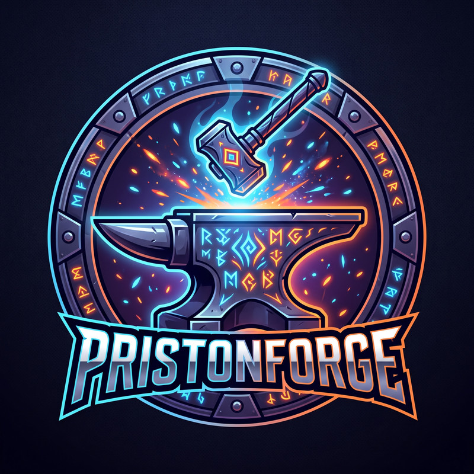

  

  # 🛡️ PristonForge
  ### O Assistente de Elite para Clãs de Priston Tale (BPT)

  
  
  

  

    O assistente definitivo de Discord para clãs e jogadores de <strong>Priston Tale Brasil</strong>. 
    Acompanhe o nível da sua guilda, espie adversários e domine o tempo exato de todos os Bosses com precisão cirúrgica.
  

  
  

---

## 🔥 Forjado para a Elite

O **PristonForge** opera em nuvem com proteção inteligente para entregar informações em tempo real diretamente no servidor do seu clã:

* 🎯 **Radar de Bosses:** Monitoramento dos minutos dinâmicos (`Alfa` a `Zeta`) combinados com a tabela oficial de Bosses Especiais da Zenit.
* 🪪 **Carteira de Aventureiro:** Vincule seu personagem uma única vez e exiba seu Nível, Classe, Rank Geral, Tier e barra de progresso rumo ao Level Cap.
* 🏆 **Hall da Fama:** Ranking interno automático com o **Top 10** dos jogadores mais fortes do clã. Consulta ultrarrápida e 100% segura.
* 🔔 **Despertador Privado:** Ative um alarme para o seu Boss favorito e receba uma Mensagem Direta (DM) exatamente **10 minutos antes** dele nascer.

---

## 🚀 Como Instalar no seu Servidor (Em 1 Minuto)

Qualquer líder ou administrador de Discord pode adicionar e ativar o **PristonForge** gratuitamente em 3 passos simples:

1. **Convide o Bot:** Clique no botão **[Adicionar ao Discord](https://discord.com/oauth2/authorize?client_id=1493293459514331326&permissions=8&integration_type=0&scope=bot+applications.commands)** e selecione o servidor do seu clã.
2. **Configure o Radar:** No seu Discord, digite `/config`, escolha o **canal de texto** onde o bot enviará os avisos diários e selecione o seu **servidor** (`Awell`, `Migal`, `Midranda`, `Cronus` ou `Idhas`).
3. **Comece a Usar:** Peça para os membros usarem `/registrar` para entrarem no Hall da Fama do clã e use `/timeboss` para lançar o painel interativo!

---

## 📚 Manual Oficial de Comandos

Basta digitar `/` no chat do seu Discord e escolher o comando desejado.

### 🪪 1. O Seu Personagem e Ranking
Os comandos essenciais para acompanhar a sua evolução, o desempenho do clã e monitorar adversários.

* **`/registrar`** `nick: [SeuNick]` `servidor: [SeuServidor]`
  * **O que faz:** Vincula permanentemente o seu personagem da Zenit à sua conta do Discord.
  * **Detalhe:** Só precisa usar este comando **UMA VEZ**. Ao registrar-se, você entra oficialmente para a base do clã e destrava os comandos `/perfil` e `/topclan`.
* **`/perfil`**
  * **O que faz:** Exibe instantaneamente a sua Carteira de Aventureiro (Level, Classe, Barra de Progresso e Tier).
  * **Detalhe:** Puxa os seus dados rapidamente e inclui um botão interativo para atualizar seu nível sempre que você upar.
* **`/topclan`**
  * **O que faz:** Exibe o Hall da Fama do servidor.
  * **Detalhe:** Mostra o cobiçado **Top 10** dos jogadores de maior nível registrados no Discord do clã, com medalhas de destaque para os líderes.
* **`/consultar`** `nick: [Nick]` `servidor: [Servidor]`
  * **O que faz:** O Radar Olheiro Global. 🕵️
  * **Detalhe:** Serve para realizar pesquisas externas sem interferir no seu `/perfil`. Ideal para verificar o ranking dos seus personagens secundários (*Alts*), confirmar a classe de quem disputou *spot* com você ou investigar clãs rivais.

---

### ⚔️ 2. Caçada e Bosses
Ferramentas de precisão para garantir que você nunca perca um drop importante.

* **`/bossatual`**
  * **O que faz:** Lista todos os Bosses Especiais previstos para nascer na **hora atual**.
  * **Detalhe:** Cruza a base oficial da Wiki com os minutos dinâmicos do servidor, exibindo Nome, Nível, Mapa e o horário cravado de Alfa a Zeta.
* **`/timeboss`**
  * **O que faz:** Envia no canal oficial o painel com os minutos dinâmicos (Alfa, Beta, Gama, Delta, Ômega e Zeta) do dia.
  * **Detalhe:** Acompanha um botão interativo **`⏰ Ver Boss da Hora`** embaixo da tabela para qualquer membro consultar os bosses atuais com apenas um clique!
* **`/avisar`** `boss: [Nome do Boss]`
  * **O que faz:** Ativa um despertador pessoal para o Boss escolhido (com preenchimento automático).
  * **Detalhe:** O PristonForge enviará uma **Mensagem Direta (DM)** privada avisando você 10 minutos antes do nascimento. O alarme é de uso único e desativa sozinho após o aviso.

---

### ⚙️ 3. Comandos da Administração (Apenas Líderes)
Comandos exclusivos para membros com permissão de Administrador no servidor do Discord.

* **`/config`** `canal: [#canal]` `servidor: [Alvo]` `level_cap: [Opcional]`
  * **O que faz:** Estabelece a configuração do bot no servidor do Discord.
  * **Detalhe:** Define o canal de auto-postagem matinal, o servidor principal do clã e sincroniza a tabela oficial de Bosses.
* **`/levelcap`** `cap: [Novo Nível]`
  * **O que faz:** Atualiza rapidamente o Nível Máximo do servidor.
  * **Detalhe:** Recalibra o cálculo matemático das barras de progresso de todos os membros quando a Zenit lança expansões de nível.
* **`/status`** e **`/ajuda`**
  * **O que fazem:** Diagnóstico técnico e resumo rápido.
  * **Detalhe:** O `/status` exibe o servidor configurado, o canal ativo e a latência (Ping). O `/ajuda` mostra um painel resumido dos comandos no chat.

---

## 💡 Dica de Ouro: Botões Interativos!

Você não precisa digitar comandos repetidamente! Os painéis gerados pelo **PristonForge** possuem botões inteligentes logo abaixo das mensagens para facilitar a sua *gameplay*:

* **`🔄 Atualizar Dados`** *(no `/perfil`)*: Recalcula seu nível e posição no ranking oficial.
* **`🔄 Atualizar Painel (Local)`** *(no `/topclan`)*: Atualiza a tabela do Top 10 instantaneamente com os últimos níveis registrados pelos membros.
* **`⏰ Ver Boss da Hora`** *(no `/timeboss` e no post automático diário)*: Exibe de forma privada para você quais Bosses nascem naquela hora exata, sem poluir o chat do clã!

---

## 🛡️ Base de Bosses Oficial

Lista de Bosses Especiais integrada no núcleo do bot de acordo com a **Wiki Oficial do Priston Tale Brasil**:

| 👑 Boss Especial | ⭐ Nível | 🗺️ Mapa Oficial | ⏰ Janelas de Horário (Time Boss) |
| :--- | :---: | :--- | :--- |
| **Babel (I1)** | `105` | Estrada de Ferro do Caos | `00:xx, 03:xx, 06:xx, 09:xx, 12:xx, 15:xx, 18:xx, 21:xx` |
| **Babel (I2)** | `105` | Coração de Perum | `01:xx, 04:xx, 07:xx, 10:xx, 13:xx, 16:xx, 19:xx, 22:xx` |
| **Fúria** | `105` | Templo Maldito - 3º Andar | `02:xx, 05:xx, 08:xx, 11:xx, 14:xx, 17:xx, 20:xx, 23:xx` |
| **Valento** | `110` | Vale Gallubia | `01:xx, 05:xx, 09:xx, 13:xx, 17:xx, 21:xx` |
| **Kelvezu** | `115` | Covil do Kelvezu | `01:xx, 07:xx, 13:xx, 19:xx` |
| **Mokova** | `120` | Templo Perdido | `02:xx, 08:xx, 14:xx, 20:xx` |
| **Shy** | `125` | Torre Sem Fim - 3º Andar | `07:xx, 15:xx, 23:xx` |
| **Tulla** | `130` | Mina de Gelo - 1º Andar | `04:xx, 12:xx, 20:xx` |
| **Draxos** | `135` | Laboratório Secreto | `09:xx, 19:xx` |
| **Greedy** | `140` | Arma Antiga | `10:xx, 21:xx` |
| **Espectro do Midranda** | `150` | Estrada Sombria | `11:xx, 19:xx` |
| **Dragão de Snowstorm** | `160` | Abismo do Mar Congelado | `11:xx, 22:xx` |
| **Yagditha** | `160` | Abismo do Mar | `04:xx, 10:xx, 16:xx, 22:xx` |
| **Zuepi** | `55 a 165` | Vários Mapas | `05:xx, 11:xx, 17:xx, 23:xx` |
| **Midranda Ressurgido** | `180` | Santuário do Abismo | `19:xx` |
| **Dama Flamejante** | `190` | Coração de Fogo | `22:xx, 23:xx` |

---

  <h3>Pronto para elevar o nível do seu clã?</h3>
  
Instale o <strong>PristonForge</strong> agora mesmo e domine os mapas do BPT!

  

   
  Desenvolvido por <strong>fromacedo</strong> 
  &copy; 2026 PristonForge. Todos os direitos reservados.

